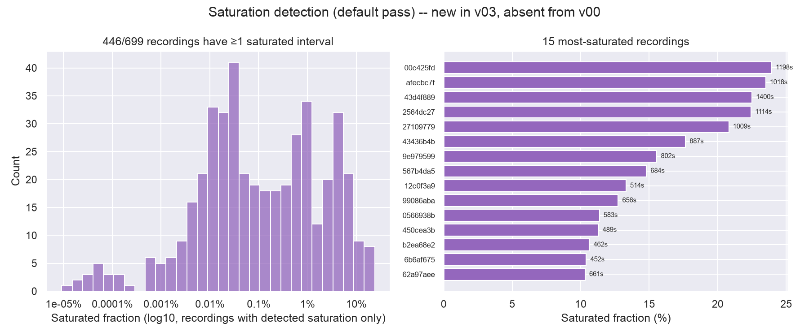
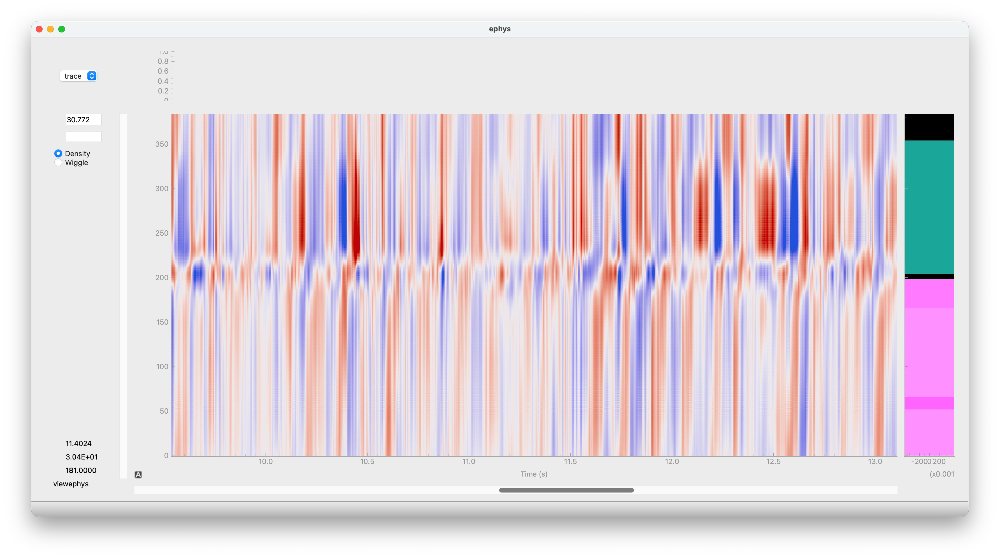

The Brain-Wide Map (BWM) LFP dataset holds 699 recordings of 384 channels in one `.h5` file,
published in three tiers that differ only in the wavelet threshold α
([choosing α](../index.qmd#choosing-α)). Every file has the same layout and the same 699
recordings.

| Tier | α | File | Size | File / float32 at 250 Hz |
|---|---:|---|---:|---:|
| small | 14 | `lf_compressed_v04_a14_small_all_bwm.h5` | 7.7 GB | 0.57 % |
| default | 7 | `lf_compressed_v04_a07_default_all_bwm.h5` | 14.9 GB | 1.10 % |
| fine | 2.5 | `lf_compressed_v04_a2p5_fine_all_bwm.h5` | 31.9 GB | 2.36 % |

`small` decodes wheel speed, choice, feedback and brain region about as well as the retired
v03 `mild` tier at 0.38× its size; `fine` recovers the scores of the uncompressed signal
for behaviour. Start with `default`. The v03 files (`lf_compressed_all_bwm.h5`,
`lf_compressed_mild_all_bwm.h5`, `lf_compressed_aggressive_all_bwm.h5`) are format 1 and
superseded.

## Browse online

**[lfpack.internationalbrainlab.org](https://lfpack.internationalbrainlab.org/app)**
hosts a live web viewer over the dataset: pick a recording (searchable by `pid`) or filter by
brain region (acronym or name, e.g. `VISp` or `Isocortex`, matching the region and its Allen
descendants), then pan, zoom and adjust gain. No download needed.

## Download

No AWS credentials are needed; the files are in the public IBL bucket:

```python
from one.remote.aws import s3_download_file

s3_download_file(
    source="resources/ibl-agent-data/lf_compressed_v04_a07_default_all_bwm.h5",
    destination="lf_compressed_v04_a07_default_all_bwm.h5",
)
```

`s3_download_file` shows a progress bar and skips the download if the local file already has
the right size.

## Limitations

- **Saturation.** ADC-clipped stretches are flagged and muted in the output. 446 of the 699
  recordings have at least one; check [your window](#quality-control-saturation) before
  trusting amplitude.
- **High frequencies.** Power above roughly 20–30 Hz is traded for compression, more so at
  `small` than at `fine`.
- **CSD.** The archives were denoised with the v04 Cadzow, whose CSD has seams every 16
  channels, and the codec smooths fine spatial structure: check CSD features that persist
  over a chunk against uncompressed data. Cadzow in lfpack ≥ 1.1 has no seams; no BWM archive
  uses it yet.
- **Low frequencies.** Per-channel impedance and analog-filter differences leave
  channel-to-channel amplitude outliers below 1.5 Hz that the pre-processing does not fully
  correct.

{.lightbox}

## Before you start

- **Align with trial events via `sr.times`.** Each recording stores a sync-corrected session
  clock; do not use `np.arange / sr.fs`. See [Read lfpack files](read-files.qmd#session-clock-times).
- **Bin channels for brain-wide sweeps.** `bin_channels=4` reduces each recording to 96
  spatial bins. See [binned reads](read-files.qmd#bin-channels-while-reading).

```python
from lfpack import LFPackReader

file_lfpack = "lf_compressed_v04_a07_default_all_bwm.h5"
pid = "dab512bd-a02d-4c1f-8dbc-9155a163efc0"

sr = LFPackReader(file_lfpack, recording=pid)
traces = sr[: int(10 * sr.fs)]     # (2500, 384) float32, volts
t = sr.times[: len(traces)]        # session-clock seconds
```

`LFPackReader.recordings(file_lfpack)` lists the 699 `pid`s.

## Quality control: saturation {#quality-control-saturation}

Each recording carries a table of saturated spans, detected on the raw band before any
filtering and zeroed in the decompressed output:

```python
sr.saturation             # DataFrame: start_sample, stop_sample (raw-rate samples)
sr.saturation_summary     # saturated_fraction, n_intervals, total_saturated_sec, muted, ...
sr.saturation_times()     # the table plus start_time, stop_time (session clock)

n = int(10 * sr.fs)
mask = sr.saturation_mask[:n]       # (n,) bool at the reader's rate, True where saturated
traces_clean = sr[:n][~mask]
```

All four return empty or default values for recordings without saturation detection, so the
same code runs on the whole dataset.

## Channel brain locations

Brain locations are embedded in each file; no network call is needed:

```python
ch = sr.channels
ch["acronym"][:5]    # Allen acronym per channel
ch["atlas_id"][:5]   # Allen CCF structure IDs, int32
ch["labels"][:5]     # 0 good, 1 dead, 2 noisy, 3 outside the brain
ch["x"][:5], ch["y"][:5], ch["z"][:5]   # ML, AP, DV in metres
```

With `bin_channels`, coordinates are averaged and regions take the within-group mode;
`sr.channels_full` always returns the raw electrodes.

## Visualise with viewephys

```bash
uv pip install "viewephys[lfpack]"
viewephys -f lf_compressed_v04_a07_default_all_bwm.h5
```

The viewer has a searchable recording selector, colours the depth axis by brain region from
the embedded annotations, and adds a CSD view.

{fig-alt="viewephys density view showing 384-channel LFP data with a brain region colour bar and a searchable recording selector" .lightbox}
